<picture>
  <source media="(prefers-reduced-motion: reduce) and (max-width: 640px)" srcset="assets/lab/still/hero-mobile.svg">
  <source media="(prefers-reduced-motion: reduce)" srcset="assets/lab/still/hero.svg">
  <source media="(max-width: 640px)" srcset="assets/lab/hero-mobile.svg">
  
</picture>

I’m <a href="https://github.com/xiaore-dev"><strong>Xiaore</strong></a>. I explore the engineering behind AI agents, from how language models choose tools to how we test those choices.

<a href="#intelligence-loop">01&nbsp;Loop</a> &ensp; <a href="#technology-radar">02&nbsp;Radar</a> &ensp; <a href="#development-environment">03&nbsp;Tools</a> &ensp; <a href="https://xiaore.xyz">04&nbsp;xiaore.xyz&nbsp;↗</a>

<picture>
  <source media="(prefers-reduced-motion: reduce)" srcset="assets/lab/still/divider.svg">
  
</picture>

<picture>
  <source media="(prefers-reduced-motion: reduce) and (max-width: 640px)" srcset="assets/lab/still/loop-mobile.svg">
  <source media="(prefers-reduced-motion: reduce)" srcset="assets/lab/still/loop.svg">
  <source media="(max-width: 640px)" srcset="assets/lab/loop-mobile.svg">
  
</picture>

<picture>
  <source media="(prefers-reduced-motion: reduce) and (max-width: 640px)" srcset="assets/lab/still/radar-mobile.svg">
  <source media="(prefers-reduced-motion: reduce)" srcset="assets/lab/still/radar.svg">
  <source media="(max-width: 640px)" srcset="assets/lab/radar-mobile.svg">
  
</picture>

<picture>
  <source media="(prefers-reduced-motion: reduce) and (max-width: 640px)" srcset="assets/lab/still/environment-mobile.svg">
  <source media="(prefers-reduced-motion: reduce)" srcset="assets/lab/still/environment.svg">
  <source media="(max-width: 640px)" srcset="assets/lab/environment-mobile.svg">
  
</picture>

<a href="https://xiaore.xyz">
<picture>
  <source media="(prefers-reduced-motion: reduce)" srcset="assets/lab/still/garden.svg">
  
</picture>
</a>

<picture>
  <source media="(prefers-reduced-motion: reduce)" srcset="assets/lab/still/footer.svg">
  
</picture>
