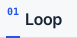
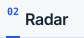
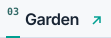

<picture>
  <source media="(prefers-reduced-motion: reduce) and (max-width: 640px)" srcset="assets/lab/still/hero-mobile.svg">
  <source media="(prefers-reduced-motion: reduce)" srcset="assets/lab/still/hero.svg">
  <source media="(max-width: 640px)" srcset="assets/lab/hero-mobile.svg">
  
</picture>

I’m <a href="https://github.com/xiaore-dev"><strong>Xiaore</strong></a>. I explore how AI agents choose tools and how to test those decisions.

  
  
  

<picture>
  <source media="(prefers-reduced-motion: reduce)" srcset="assets/lab/still/divider.svg">
  
</picture>

<picture>
  <source media="(prefers-reduced-motion: reduce) and (max-width: 640px)" srcset="assets/lab/still/loop-mobile.svg">
  <source media="(prefers-reduced-motion: reduce)" srcset="assets/lab/still/loop.svg">
  <source media="(max-width: 640px)" srcset="assets/lab/loop-mobile.svg">
  
</picture>

<picture>
  <source media="(prefers-reduced-motion: reduce) and (max-width: 640px)" srcset="assets/lab/still/radar-mobile.svg">
  <source media="(prefers-reduced-motion: reduce)" srcset="assets/lab/still/radar.svg">
  <source media="(max-width: 640px)" srcset="assets/lab/radar-mobile.svg">
  
</picture>

<a href="https://xiaore.xyz">
<picture>
  <source media="(prefers-reduced-motion: reduce)" srcset="assets/lab/still/garden.svg">
  
</picture>
</a>

<picture>
  <source media="(prefers-reduced-motion: reduce)" srcset="assets/lab/still/footer.svg">
  
</picture>
