<picture>
  <source media="(prefers-reduced-motion: reduce) and (max-width: 640px)" srcset="assets/lab/still/hero-mobile.svg">
  <source media="(prefers-reduced-motion: reduce)" srcset="assets/lab/still/hero.svg">
  <source media="(max-width: 640px)" srcset="assets/lab/hero-mobile.svg">
  
</picture>

<h2>About Me</h2>

I’m <a href="https://github.com/xiaore-dev"><strong>Xiaore</strong></a>. I explore AI engineering and software engineering. I’m especially interested in how LLM-based agents choose tools and how to test those choices.

<picture>
  <source media="(prefers-reduced-motion: reduce)" srcset="assets/lab/still/divider.svg">
  
</picture>

<h2>Intelligence Loop</h2>

In this conceptual loop, an agent observes the result of one action and uses it to decide what to do next.

<picture>
  <source media="(prefers-reduced-motion: reduce) and (max-width: 640px)" srcset="assets/lab/still/loop-mobile.svg">
  <source media="(prefers-reduced-motion: reduce)" srcset="assets/lab/still/loop.svg">
  <source media="(max-width: 640px)" srcset="assets/lab/loop-mobile.svg">
  
</picture>

<h2>Technology Radar</h2>

I’m exploring agent architecture and LLM inference, from context engineering and RAG to tool calling with MCP. Software engineering connects these topics.

<picture>
  <source media="(prefers-reduced-motion: reduce) and (max-width: 640px)" srcset="assets/lab/still/radar-mobile.svg">
  <source media="(prefers-reduced-motion: reduce)" srcset="assets/lab/still/radar.svg">
  <source media="(max-width: 640px)" srcset="assets/lab/radar-mobile.svg">
  
</picture>

<h2>Development Environment</h2>

I use Python and TypeScript for implementation, Pydantic for data validation, and Playwright for browser tests.

<picture>
  <source media="(prefers-reduced-motion: reduce) and (max-width: 640px)" srcset="assets/lab/still/environment-mobile.svg">
  <source media="(prefers-reduced-motion: reduce)" srcset="assets/lab/still/environment.svg">
  <source media="(max-width: 640px)" srcset="assets/lab/environment-mobile.svg">
  
</picture>

<h2>Digital Garden</h2>

My personal blog lives at <a href="https://xiaore.xyz">xiaore.xyz</a>.

<a href="https://xiaore.xyz">
<picture>
  <source media="(prefers-reduced-motion: reduce)" srcset="assets/lab/still/garden.svg">
  
</picture>
</a>

<picture>
  <source media="(prefers-reduced-motion: reduce)" srcset="assets/lab/still/footer.svg">
  
</picture>
