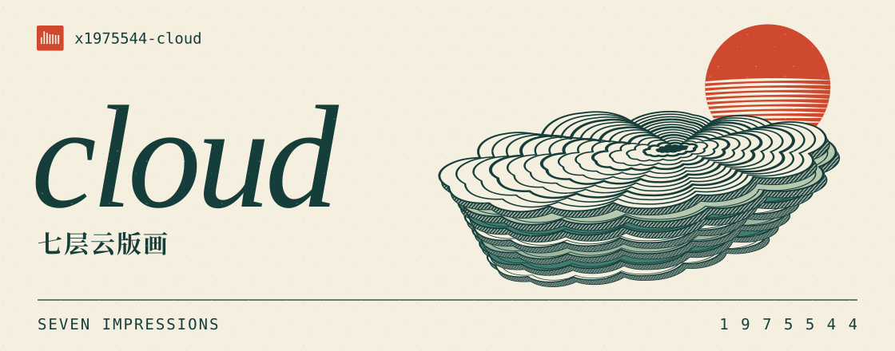

<picture>
  <source media="(max-width: 600px)" srcset="./assets/cloud-press-mobile.svg">
  
</picture>

## 项目索引

 **[小热阅读](https://github.com/x1975544-cloud/ai-coding)** 
在浏览器里读本地 TXT，下次从上回读到的位置继续。

 **[SpecFlow · 规流](https://github.com/x1975544-cloud/SpecFlow)** 
从需求规格到测试验收，在本地追溯每一步的审批与执行记录。

 **[PiX Agent](https://github.com/x1975544-cloud/pix-agent)** 
在可视化界面中查看编程 Agent 如何检索仓库、调用工具和运行测试。

 **[react-agent](https://github.com/x1975544-cloud/react-agent)** 
轻量 Python ReAct 框架，在命令行对话中调用工具并回传结果。

[浏览全部公开仓库 →](https://github.com/x1975544-cloud?tab=repositories)
